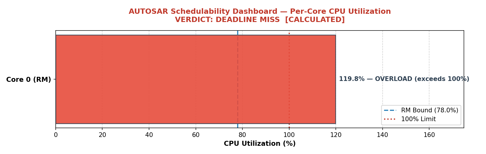
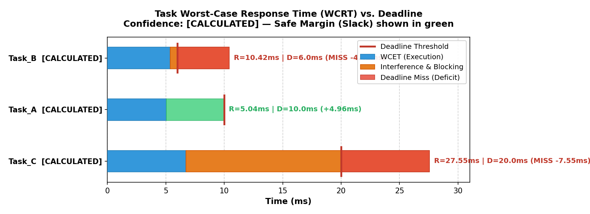
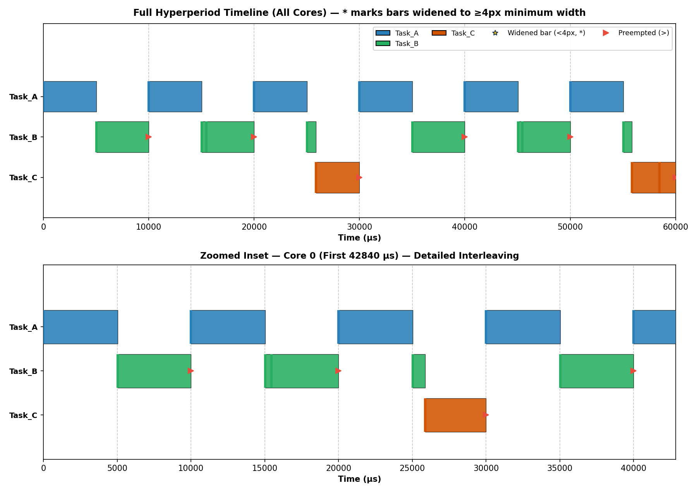

# EmbedSched

> **A post-compile schedulability analyzer for ARM Cortex-M firmware.**  
> Derives per-task WCET from build artifacts, runs Response Time Analysis, and produces confidence-tagged timing reports — without requiring hardware.

---

## Why This Exists

Commercial schedulability tools (TA Tool Suite, SymTA/S, aiT) cost tens of thousands of euros and require hardware availability. Engineers typically run timing analysis only after hardware arrives — weeks before tape-out, when fixes are expensive.

**EmbedSched** runs on your build artifacts the moment the compiler finishes. No hardware. No license. It catches deadline misses, stack overflow under preemption, ISR placement penalties, and multicore deadlock risks in your CI pipeline before silicon is available.

---

## Table of Contents

- [Why This Exists](#why-this-exists)
- [Overview](#overview)
- [What It Checks](#what-it-checks)
- [Validation](#validation)
- [Visual Output Examples](#visual-output-examples)
- [CI/CD Pipeline Integration](#cicd-pipeline-integration)
- [Confidence Tags](#confidence-tags)
- [Prerequisites](#prerequisites)
- [Installation](#installation)
- [Quick Start](#quick-start)
- [CLI Reference](#cli-reference)
- [Required Inputs](#required-inputs)
  - [Firmware Build Artifacts](#firmware-build-artifacts)
  - [Chip Profile YAML](#chip-profile-yaml)
  - [AUTOSAR Schedule Configuration (`schedule.json`)](#autosar-schedule-configuration-schedulejson)
  - [Optional: Renode Trace](#optional-renode-trace)
- [Project Structure](#project-structure)
- [SDK Reference](#sdk-reference)
  - [Parsers](#parsers)
  - [Models](#models)
  - [Analysis Engine](#analysis-engine)
  - [Rule Engine](#rule-engine)
  - [Simulation Layer](#simulation-layer)
  - [Reporting & Visualization](#reporting--visualization)
- [AUTOSAR Schedulability & Timing Extension](#autosar-schedulability--timing-extension)
  - [Response Time Analysis (RTA) Engine](#response-time-analysis-rta-engine)
  - [Multi-Core Scheduling & Deadlock Analysis](#multi-core-scheduling--deadlock-analysis)
  - [Hardware-Aware ISR Integration](#hardware-aware-isr-integration)
  - [Discrete-Event Scheduler Simulation & Jitter Analysis](#discrete-event-scheduler-simulation--jitter-analysis)
  - [Visual Artifacts & Matplotlib Charts](#visual-artifacts--matplotlib-charts)
- [Rule Engine Deep Dive](#rule-engine-deep-dive)
  - [Hardware Architecture Rules (Rules 1–9)](#rule-1--isr-placement)
  - [AUTOSAR Timing & Schedulability Rules (Rules 10–16)](#autosar-timing--schedulability-rules)
- [Chip Profiles](#chip-profiles)
  - [Supported Chips](#supported-chips)
  - [YAML Schema](#yaml-schema)
  - [Adding a New Chip](#adding-a-new-chip)
- [Scoring Model](#scoring-model)
- [Sample Output](#sample-output)
- [Renode Integration](#renode-integration)
- [Limitations](#limitations)
  - [What This Tool Is Not](#what-this-tool-is-not)
  - [Technical Limitations Matrix](#technical-limitations-matrix)

---

## Overview

Most embedded engineers discover firmware efficiency problems only when something fails in the field — an ISR misses its deadline, a DMA transfer corrupts memory, or a stack overflow silently corrupts state. These issues are detectable **before runtime** by reading the build artifacts with the right knowledge.

**EmbedSched** encodes the same checks a senior embedded engineer applies by eye (reading `.map` files, auditing linker scripts, reviewing section placement) into an automated pipeline that runs on any ARM Cortex-M firmware workspace.

**What it answers:**
- Is this firmware using the hardware correctly?
- Are ISR handlers placed in zero-wait-state memory?
- Are DMA buffers aligned for D-cache safety?
- Could a stack overflow happen under the worst-case call chain?
- Is ITCM nearly full?
- Are DMA and CPU competing for the same bus port?
- Will the AUTOSAR/RTOS task set meet all hard real-time deadlines under worst-case preemption (RTA)?
- Does CPU utilization exceed schedulability bounds (Liu & Layland RM / EDF)?
- Are shared resources protected against priority inversion and multi-core deadlocks?
- What are the worst-case response times, slack margins, and start-time jitter across all task activations?

**Target users:** Embedded firmware engineers, functional safety architects, and RTOS developers who need pre-hardware verification of memory layout, hardware configuration, and real-time schedulability.

---

## What It Checks

### Hardware & Memory Architecture Checks

| Rule | Category | Severity |
|---|---|---|
| ISR handler in FLASH instead of ITCM/CCM | Interrupt latency / determinism | WARNING |
| DMA bus matrix contention (CPU + DMA on same AHB port) | Bandwidth / throughput | WARNING |
| ITCM section over capacity | Hard link error risk | CRITICAL |
| Worst-case stack depth exceeds safe threshold | Stack overflow / silent corruption | CRITICAL |
| Unaligned DMA buffer (D-cache maintenance corruption) | Data integrity | INFO |
| No explicit stack section in linker script | Stack safety | WARNING |
| Chip-specific constraints (e.g., no ITCM on STM32F407) | Architecture correctness | INFO |

### AUTOSAR Real-Time Schedulability Checks

| Rule | Category | Severity |
|---|---|---|
| Task deadline miss ($R_i > D_i$ under RTA) | Real-Time Timing / Schedulability | CRITICAL |
| CPU utilization overload ($U > 100\%$ or exceeds RM bound) | Processor Capacity / Feasibility | CRITICAL / WARNING |
| Multi-core resource deadlock risk (circular locking) | Concurrency / Synchronization | WARNING / CRITICAL |
| Task WCET dominates period ($C_i / T_i > 50\%$) | Task Architecture / Starvation Risk | WARNING |
| Sub-optimal Rate Monotonic priority assignment ($D < T$) | Priority Assignment / Schedulability | INFO |
| Priority Ceiling Protocol (PCP) blocking bounded | Resource Sharing / Latency | INFO |
| AUTOSAR entry function mismatch / exclusion | Configuration Validation | CRITICAL |

---

## Validation

Tested against 12 adversarial test cases covering RM boundary conditions, deadline misses, PCP blocking, multicore EDF, ISR interference, stack overflow under preemption, hyperperiod explosion, and deadlock detection.

| Test Case | Purpose | Result |
|---|---|---|
| **TC1 — Baseline** | End-to-end pipeline verification | ✓ Pass |
| **TC2 — RM boundary** | Utilization > Liu & Layland bound, exact RTA passes | ✓ Pass |
| **TC3 — Deadline miss** | Misses deadline despite passing utilization test | ✓ Detected |
| **TC4 — PCP blocking** | Priority inversion strictly bounded to one critical section | ✓ Pass |
| **TC5 — Multicore EDF** | Dynamic EDF on Core 0, fixed-priority RM on Core 1 | ✓ Pass |
| **TC6 — ISR interference** | Hardware ISR auto-detected and injected into RTA | ✓ Detected |
| **TC7 — Concurrent stack** | 4,128B > 4,096B under full preemption call depth | ✓ Detected |
| **TC8 — EDF demand bound** | Constrained deadline ($D < T$), Processor Demand Analysis | ✓ Pass |
| **TC9 — Hyperperiod explosion** | LCM = 323,323 ms, simulation capped safely at 200 ms | ✓ Handled |
| **TC10 — Deadlock** | Circular mutex acquisition order across cores (AB/BA) | ✓ Detected |
| **TC11 — Confidence propagation** | `[HEURISTIC]` WCET tags propagate to verdict banner | ✓ Pass |
| **TC12 — Symbol mismatch** | Entry function typo triggers Levenshtein suggestion | ✓ Pass |

---

## Visual Output Examples

EmbedSched generates vector-quality Matplotlib figures for design reviews, safety case documentation, and CI reporting artifacts:

### Schedulability Dashboard


### Response Time vs Deadline


### Execution Timeline (Gantt Chart)


---

## CI/CD Pipeline Integration

EmbedSched runs non-interactively in standard CI/CD pipelines (GitHub Actions, GitLab CI, Jenkins). It exits with code 1 if any `CRITICAL` findings (e.g. deadline misses, stack overflow under preemption, deadlocks) are detected, preventing broken firmware from merging:

```yaml
# .github/workflows/firmware-check.yml
name: Firmware Schedulability & Safety Audit

on: [push, pull_request]

jobs:
  schedulability-check:
    runs-on: ubuntu-latest
    steps:
      - uses: actions/checkout@v4

      - name: Set up Python
        uses: actions/setup-python@v5
        with:
          python-version: '3.10'

      - name: Install Dependencies
        run: pip install -r requirements.txt

      - name: Run EmbedSched
        run: |
          python main.py \
            --elf build/firmware.elf \
            --map build/firmware.map \
            --ld  src/linker.ld \
            --chip chips/stm32f407.yaml \
            --autosar-config schedule.json \
            --charts-dir artifacts/charts/
        # Non-zero exit code on CRITICAL findings blocks merge

      - name: Upload Timing Charts
        if: always()
        uses: actions/upload-artifact@v4
        with:
          name: timing-charts
          path: artifacts/charts/
```

---

## Confidence Tags

Every finding carries an explicit confidence tag so the tool never overclaims:

| Tag | Meaning |
|---|---|
| `[STATIC]` | Ground truth from `.map`/`.elf` parsing. No estimation involved. |
| `[CALCULATED]` | Derived from datasheet arithmetic + ARMv7-M Architecture Reference Manual. Sourced and citable. |
| `[SIMULATED]` | From Renode functional execution trace. Accurate call counts, approximate timing. |
| `[HEURISTIC]` | Pattern match on symbol or section names. No timing claim made. |

---

## Prerequisites

| Dependency | Purpose | Required |
|---|---|---|
| Python 3.9+ | Runtime | Yes |
| `arm-none-eabi-objdump` | ELF disassembly for call graph | Yes |
| `pyyaml` | Chip profile YAML parsing | Yes |
| `matplotlib` | High-resolution schedulability dashboards, Gantt, and jitter charts | Recommended (Optional) |
| `pyelftools` | ELF fallback parsing | Optional |
| `capstone` | Disassembly fallback | Optional |
| Renode | Live hardware simulation | Optional |

Install Python dependencies:

```bash
pip install pyyaml matplotlib pyelftools capstone
```

Ensure `arm-none-eabi-objdump` is on your `PATH` (part of the [GNU Arm Embedded Toolchain](https://developer.arm.com/downloads/-/gnu-rm)).

---

## Installation

```bash
git clone https://github.com/your-org/firmware-analyzer.git
cd firmware-analyzer
pip install pyyaml
```

No build step required — the tool runs directly as a Python script.

---

## Quick Start

```bash
python main.py \
  --elf    path/to/firmware.elf \
  --map    path/to/firmware.map \
  --ld     path/to/linker.ld \
  --chip   chips/stm32f746.yaml \
  --su-dir path/to/build/ \
  --startup path/to/startup_stm32f746xx.s \
  --freq-mhz 216
```

**Minimal run** (no stack analysis, no ISR detection):

```bash
python main.py \
  --elf firmware.elf \
  --map firmware.map \
  --ld  linker.ld \
  --chip chips/stm32f407.yaml
```

**With AUTOSAR OS Schedulability Analysis and Visual Charts:**

```bash
python main.py \
  --elf            firmware.elf \
  --map            firmware.map \
  --ld             linker.ld \
  --chip           chips/stm32f407.yaml \
  --autosar-config schedule.json \
  --charts-dir     charts/ \
  --stochastic-sim
```

**With live Renode simulation:**

```bash
python main.py \
  --elf firmware.elf \
  --map firmware.map \
  --ld  linker.ld \
  --chip chips/stm32f746.yaml \
  --renode-repl platform/stm32f746.repl \
  --renode-sim-ms 2000
```

**With a pre-captured Renode trace:**

```bash
python main.py \
  --elf firmware.elf \
  --map firmware.map \
  --ld  linker.ld \
  --chip chips/stm32f746.yaml \
  --renode-trace exec_trace.txt
```

---

## CLI Reference

| Argument | Type | Required | Description |
|---|---|---|---|
| `--elf` | path | ✅ | Path to `firmware.elf` |
| `--map` | path | ✅ | Path to `firmware.map` |
| `--ld` | path | ✅ | Path to the linker script (`.ld`) |
| `--chip` | path | ✅ | Path to chip profile YAML (e.g. `chips/stm32f746.yaml`) |
| `--autosar-config` | path | — | Path to AUTOSAR task & core schedule JSON (`schedule.json`) |
| `--charts-dir` | path | — | Directory to output visual Matplotlib charts (Outputs 1–4) |
| `--stochastic-sim` | flag | — | Enable stochastic execution time variation (85%–100% WCET) in scheduler simulation |
| `--no-autosar-sim` | flag | — | Disable discrete-event scheduler simulation (run analytical RTA only) |
| `--su-dir` | path | — | Directory containing `.su` files (enables stack analysis) |
| `--startup` | path | — | Path to startup assembly file (enables ISR detection) |
| `--freq-mhz` | float | — | MCU frequency in MHz (defaults to chip profile max) |
| `--renode-trace` | path | — | Path to a pre-captured Renode trace file |
| `--renode-repl` | path | — | Path to Renode `.repl` platform description (triggers live simulation) |
| `--renode-sim-ms` | int | — | Duration to run Renode simulation, default: `2000` ms |
| `--hot-funcs` | string | — | Comma-separated list of performance-critical functions for Flash cache locality audit |

---

## Required Inputs

### Firmware Build Artifacts

These come from your normal firmware build process.

#### `firmware.elf`

The linked ELF binary. Provides symbol addresses, sizes, section membership, and debug info.

**How to produce:**
```bash
arm-none-eabi-gcc ... -o firmware.elf
```

#### `firmware.map`

The linker map file. Contains every symbol's final address, size, and source object file.

**How to produce:**  
Add `-Wl,-Map=firmware.map` to your linker flags.

The parser extracts symbols in this format:
```
 .text.adc_dma_isr       0x0000000c   0x48   build/adc.o
 .text.main_loop         0x08004120   0x340  build/main.o
 .dma_bufs.spi_rx_buf    0x20010000   0x400  build/spi.o
```

It also extracts special linker-computed symbols: `_estack`, `__bss_end__`, `_Min_Stack_Size`, etc.

#### `.su` files (stack usage)

Per-function static stack frame sizes emitted by GCC.

**How to produce:**  
Add `-fstack-usage` to your compiler flags. GCC emits one `.su` file per compiled `.c` file.

File format:
```
src/adc.c:45:12:adc_dma_isr    48    static
src/main.c:112:8:update_pid   128    static
src/main.c:200:5:log_telemetry 96   static
```

Frame types:
- `static` — fixed frame size, fully bounded
- `dynamic` — frame grows at runtime (VLAs, `alloca`) — flagged as unbounded
- `dynamic,bounded` — dynamic but with a known maximum

#### `startup_*.s`

The startup assembly file containing the vector table. Used to identify all ISR handler names.

```asm
g_pfnVectors:
    .word  _estack
    .word  Reset_Handler
    .word  NMI_Handler
    .word  HardFault_Handler
    ...
    .word  DMA1_Stream0_IRQHandler
    .word  ADC_IRQHandler
```

Every function pointer in this table is treated as an ISR entry point.

#### Linker script (`.ld`)

Provides memory region definitions, section-to-region assignments, and stack size declarations.

```ld
MEMORY {
    FLASH  (rx)  : ORIGIN = 0x08000000, LENGTH = 1024K
    ITCM   (rwx) : ORIGIN = 0x00000000, LENGTH = 16K
    DTCM   (rw)  : ORIGIN = 0x20000000, LENGTH = 64K
    SRAM1  (rw)  : ORIGIN = 0x20010000, LENGTH = 240K
    SRAM2  (rw)  : ORIGIN = 0x2004C000, LENGTH = 16K
}
```

---

### Chip Profile YAML

A YAML file describing the target MCU's memory topology, bus matrix, cache configuration, and flash wait-state table. These are bundled with the tool in the `chips/` directory.

See the [Chip Profiles](#chip-profiles) section for the full schema and how to add new chips.

---

### AUTOSAR Schedule Configuration (`schedule.json`)

Defines the multi-core real-time task architecture, core scheduling algorithms, task timing parameters, shared resources, and inter-core communication channels.

```json
{
  "chip": "stm32f407.yaml",
  "cores": [
    { "id": 0, "algorithm": "RM", "preemptive": true },
    { "id": 1, "algorithm": "EDF", "preemptive": true }
  ],
  "tasks": [
    {
      "name": "Task_MotorControl",
      "entry_function": "motor_control_loop",
      "period_ms": 1,
      "deadline_ms": 1,
      "priority": 1,
      "core": 0,
      "resource_locks": ["RES_SPI_BUS"]
    },
    {
      "name": "Task_Telemetry",
      "entry_function": "telemetry_update",
      "period_ms": 10,
      "deadline_ms": 8,
      "priority": 2,
      "core": 0
    }
  ],
  "resources": [
    { "name": "RES_SPI_BUS", "ceiling_priority": 1 }
  ],
  "inter_core_channels": [
    { "name": "IPC_CORE0_TO_CORE1", "source_core": 0, "dest_core": 1, "blocking_time_us": 15.0 }
  ]
}
```

**Task timing attributes:**
- `period_ms` / `period_us`: Task activation period.
- `deadline_ms` / `deadline_us`: Relative deadline (supports implicit $D=T$, constrained $D < T$, and arbitrary deadlines).
- `priority`: Static priority integer (1 = highest priority; required for RM/DM, `null` or 255 for EDF).
- `core`: CPU core assignment (0, 1, ...).
- `resource_locks`: List of shared resource IDs locked during task execution.

---

### Optional: Renode Trace

A plain-text execution trace captured from Renode simulation. Each line contains a simulated cycle count and program counter value. The tool resolves PC addresses to function names via the ELF symbol table and builds a call frequency profile.

If not provided, dynamic profile data is omitted and hot-path analysis falls back to heuristics.

---

## Project Structure

```
firmware_analyzer/
│
├── main.py                     # CLI entry point and analysis pipeline
│
├── parsers/
│   ├── map_parser.py           # .map → list of Symbol objects
│   ├── ld_parser.py            # linker script → MemoryRegion[], stack config
│   ├── su_parser.py            # .su files → {func_name: frame_bytes}
│   ├── elf_parser.py           # arm-none-eabi-objdump → disassembly, call graph
│   ├── startup_parser.py       # startup_*.s → list of ISR handler names
│   └── autosar_parser.py       # schedule.json → AutosarConfig (tasks, cores, resources)
│
├── models/
│   ├── chip_profile.py         # YAML chip profile loader and validator
│   ├── symbol.py               # Symbol dataclass (name, address, size, section, obj)
│   ├── finding.py              # Finding dataclass (rule, severity, tag, message, fix)
│   └── autosar_task.py         # AutosarTask, AutosarCore, Resource, IPCChannel models
│
├── analysis/
│   ├── region_classifier.py    # Symbol address → memory region name
│   ├── call_graph.py           # Build call graph from disassembly
│   ├── stack_analyzer.py       # Worst-case stack depth DFS
│   ├── timing_model.py         # Datasheet-derived latency calculations
│   ├── wcet_extractor.py       # Code-size & Renode WCET extraction + ISR modeling
│   ├── rta_engine.py           # Multi-core Response Time Analysis & Utilization
│   ├── deadlock_detector.py    # Resource Allocation Graph (RAG) deadlock detection
│   ├── scheduler_sim.py        # Discrete-event preemptive scheduler simulation & jitter
│   └── rules/
│       ├── isr_placement.py        # Rule 1: ISR in Flash vs ITCM
│       ├── bus_contention.py       # Rule 2: DMA/CPU AHB bus contention
│       ├── itcm_overflow.py        # Rule 3: ITCM section capacity check
│       ├── stack_risk.py           # Rule 4: Worst-case stack overflow
│       ├── dma_alignment.py        # Rule 5: 32-byte DMA buffer alignment
│       ├── stack_section.py        # Rule 6: No explicit stack section
│       ├── isr_blocking_calls.py   # Rule 7: ISR calling blocking functions
│       ├── stack_bss_proximity.py  # Rule 8: Stack/BSS zero gap proximity
│       ├── flash_fragmentation.py  # Rule 9: Flash cache locality audit
│       ├── chip_specific.py        # Chip-specific constraint checks
│       └── autosar_rules.py        # AUTOSAR RTA, deadline misses, overload, & deadlocks
│
├── simulation/
│   └── renode_runner.py            # Renode headless runner and trace parser
│
├── report/
│   ├── terminal_report.py          # ANSI color boxed report + firmware scoring
│   ├── text_report.py              # Plain-text file output
│   ├── autosar_report.py           # Executive Summary table + 7-section AUTOSAR report
│   ├── gantt_chart.py              # Terminal text Gantt timeline & Jitter analysis table
│   └── matplotlib_charts.py        # Production Matplotlib charts (Outputs 1, 2, 3, 4)
│
└── chips/
    ├── stm32f746.yaml               # STM32F746 (Cortex-M7, 216 MHz, ITCM/DTCM)
    ├── stm32f407.yaml               # STM32F407 (Cortex-M4, 168 MHz, CCM)
    ├── stm32g474.yaml               # STM32G474 (Cortex-M4, 170 MHz, CCM)
    └── stm32h745.yaml               # STM32H745 (Dual-Core: Cortex-M7 480MHz + M4 240MHz)
```

---

## SDK Reference

### Parsers

#### `parsers/map_parser.py`

```python
from parsers.map_parser import parse_map_file, parse_map_special_symbols

symbols = parse_map_file("firmware.map")
# → List[Symbol]

linker_syms = parse_map_special_symbols("firmware.map")
# → {'_estack': 0x20020000, '_Min_Stack_Size': 4096, ...}
```

**`parse_map_file(filepath: str) → List[Symbol]`**  
Parses a GCC linker `.map` file and returns every symbol with its name, address, size, section, and source object file. Handles single-line and split two-line GNU linker output formats. Zero-size symbols are skipped.

**`parse_map_special_symbols(filepath: str) → dict`**  
Extracts linker-computed special symbols (`_estack`, `__bss_end__`, `_Min_Stack_Size`, etc.) whose values are fully resolved expressions (like `ORIGIN(SRAM) + LENGTH(SRAM)`). These are more reliable than parsing the `.ld` file directly.

---

#### `parsers/ld_parser.py`

```python
from parsers.ld_parser import parse_ld_file, parse_ld_symbols

regions = parse_ld_file("linker.ld")
# → {'FLASH': MemoryRegion(origin=0x08000000, length=1048576, attrs='rx'), ...}

ld_syms = parse_ld_symbols("linker.ld")
# → {'_Min_Stack_Size': 0x400, '_estack': ...}
```

**`parse_ld_file(filepath: str) → dict[str, MemoryRegion]`**  
Parses the `MEMORY {}` block to extract every named region with its origin, length, and attribute flags (`rx`, `rw`, `rwx`).

**`parse_ld_symbols(filepath: str) → dict`**  
Resolves `ORIGIN()` and `LENGTH()` expressions and stack size declarations within `SECTIONS {}`. Falls back gracefully when expressions cannot be resolved statically.

---

#### `parsers/su_parser.py`

```python
from parsers.su_parser import parse_su_files

stack_usage = parse_su_files("path/to/build/")
# → {'adc_dma_isr': 48, 'update_pid': 128, 'log_telemetry': 96}
```

**`parse_su_files(directory: str) → dict[str, int]`**  
Walks a directory, finds all `.su` files, and builds a `{function_name: frame_bytes}` mapping. Functions with `dynamic` (unbounded) frame types are flagged separately in the stack risk rule.

---

#### `parsers/elf_parser.py`

```python
from parsers.elf_parser import run_objdump_disassembly

disassembly = run_objdump_disassembly("firmware.elf")
# → raw disassembly text (str) from arm-none-eabi-objdump -d
```

**`run_objdump_disassembly(elf_path: str) → str`**  
Shells out to `arm-none-eabi-objdump -d`. Falls back to `pyelftools` + `capstone` if the toolchain binary is not on `PATH`. Returns raw disassembly text consumed by the call graph builder.

---

#### `parsers/startup_parser.py`

```python
from parsers.startup_parser import parse_startup_file

isr_names = parse_startup_file("startup_stm32f746xx.s")
# → ['Reset_Handler', 'NMI_Handler', 'HardFault_Handler', 'DMA1_Stream0_IRQHandler', ...]
```

**`parse_startup_file(filepath: str) → List[str]`**  
Parses the `g_pfnVectors` (or equivalent) section in the startup assembly file and returns every function pointer name listed in the vector table. This is the authoritative ISR list — do not rely on naming conventions alone.

---

#### `parsers/autosar_parser.py`

```python
from parsers.autosar_parser import load_autosar_config

config = load_autosar_config("schedule.json", symbols)
# → AutosarConfig with cores, tasks, resources, and inter_core_channels
```

**`load_autosar_config(filepath: str, symbols: List[Symbol]) → AutosarConfig`**  
Parses the AUTOSAR configuration JSON or YAML file:
- Normalizes core scheduling algorithms (`RM`, `DM`, `EDF`) and preemption modes.
- Validates task parameters: period, deadline (defaults to period if omitted), priority (1 = highest), and core assignment.
- **Fuzzy Symbol Matching:** Validates every `entry_function` against the firmware symbol table. If a symbol name is mistyped, computes Levenshtein distance, suggests the closest matching firmware function (e.g., `Did you mean 'motor_control_loop'? (distance: 1)`), and raises an explicit error.
- Loads shared resource definitions and inter-core communication channels for Priority Ceiling Protocol and blocking latency analysis.

---

### Models

#### `models/autosar_task.py`

```python
from models.autosar_task import AutosarTask, AutosarCore, Resource, IPCChannel

task = AutosarTask(
    name="Task_MotorControl",
    function="motor_control_loop",
    period_us=1000.0,
    deadline_us=1000.0,
    priority=1,
    core_id=0,
    resource_locks=["RES_SPI_BUS"]
)
```

Core classes:
- **`AutosarTask`**: Encapsulates task attributes, timing parameters (`period_us`, `deadline_us`), priority, core binding, WCET metrics (`wcet_us`, `wcet_cycles`, `wcet_tag`), blocking terms (`blocking_time_us`), and computed response times (`wcrt_us`).
- **`AutosarCore`**: Configures CPU core ID, scheduling policy (`"RM"`, `"DM"`, or `"EDF"`), and preemption capability.
- **`Resource`**: Shared hardware/software mutex with assigned ceiling priority.
- **`IPCChannel`**: Cross-core message passing channel with measured or configured blocking latency.

---

#### `models/symbol.py`

```python
from models.symbol import Symbol

sym = Symbol(
    name="adc_dma_isr",
    address=0x0000000C,
    size=72,
    section=".text.adc_dma_isr",
    object_file="build/adc.o"
)
```

Fields:

| Field | Type | Description |
|---|---|---|
| `name` | `str` | Symbol name (function or variable) |
| `address` | `int` | Final linked address (integer) |
| `size` | `int` | Size in bytes |
| `section` | `str` | Section name (e.g. `.text.adc_dma_isr`, `.dma_bufs.spi_rx_buf`) |
| `object_file` | `str` | Source `.o` file |

---

#### `models/finding.py`

```python
from models.finding import Finding

f = Finding(
    rule="isr_in_flash",
    severity="WARNING",
    tag="[CALCULATED — ARMv7-M ARM B1.5.6]",
    message="adc_dma_isr at 0x08004120 (FLASH).\n  Calculated latency: ~176 ns vs ~55.6 ns in ITCM.",
    fix='__attribute__((section(".itcm_text")))'
)
```

Fields:

| Field | Type | Description |
|---|---|---|
| `rule` | `str` | Machine-readable rule identifier |
| `severity` | `str` | `"CRITICAL"`, `"WARNING"`, or `"INFO"` |
| `tag` | `str` | Confidence tag string (see [Confidence Tags](#confidence-tags)) |
| `message` | `str` | Human-readable description of the finding |
| `fix` | `str` | Suggested remediation |

---

#### `models/chip_profile.py`

```python
from models.chip_profile import load_chip_profile

chip = load_chip_profile("chips/stm32f746.yaml")
# → dict with keys: name, core, clock_max_mhz, cache, memory_regions,
#                   flash_wait_states, exception_entry_cycles,
#                   vector_table_section, bus_matrix
```

**`load_chip_profile(filepath: str) → dict`**  
Loads and validates a chip YAML profile. Raises `ValueError` if required keys are missing.

---

### Analysis Engine

#### `analysis/region_classifier.py`

```python
from analysis.region_classifier import classify_address

region = classify_address(0x0000000C, linker_regions, chip_regions)
# → "ITCM"

region = classify_address(0x08004120, linker_regions, chip_regions)
# → "FLASH"
```

**`classify_address(addr: int, linker_regions: dict, chip_regions: dict) → str`**  
Maps a symbol address to a memory region name by checking against linker-script-derived region boundaries first, then falling back to chip profile boundaries. Returns `"UNKNOWN"` if no region matches.

Priority: linker script regions take precedence over chip profile (linker script is the user's actual intent).

---

#### `analysis/call_graph.py`

```python
from analysis.call_graph import build_call_graph_from_disassembly

call_graph = build_call_graph_from_disassembly(disassembly_text)
# → {'main': {'update_pid', 'log_telemetry'}, 'update_pid': {'memcpy'}, ...}
```

**`build_call_graph_from_disassembly(disassembly: str) → dict[str, set[str]]`**  
Parses `BL` and `BLX` instructions from objdump output to build a static call graph. Returns a dict mapping each function to the set of functions it directly calls.

> **Limitation:** Function pointers, callbacks, and vtables break the static call graph. Functions with indirect calls are not automatically included. The stack analysis may undercount worst-case depth in those cases.

---

#### `analysis/stack_analyzer.py`

```python
from analysis.stack_analyzer import analyze_all_stacks

max_depth, max_chain, has_recursion = analyze_all_stacks(
    call_graph, stack_usage, entry_points={"main", "adc_dma_isr"}
)
# max_depth: 3840 (bytes)
# max_chain: ['main', 'update_pid', 'log_telemetry']
# has_recursion: False
```

**`analyze_all_stacks(call_graph, stack_usage, entry_points) → tuple[int, list, bool]`**  
Runs a DFS through the call graph starting from each entry point, summing `.su` frame sizes to compute worst-case stack depth. Detects cycles and flags them as unbounded recursion. Returns the maximum depth found across all entry points.

---

#### `analysis/timing_model.py`

```python
from analysis.timing_model import calc_isr_penalty_ns, lookup_wait_states

ws = lookup_wait_states(freq_mhz=216, chip=chip_profile)
# → 7  (from STM32F7 RM Table 4)

penalty = calc_isr_penalty_ns(freq_mhz=216, handler_region="FLASH", chip=chip_profile)
# → {
#     'itcm_ns':       55.6,
#     'flash_warm_ns': 92.6,
#     'flash_cold_ns': 351.9,
#     'citation':      'ARMv7-M ARM §B1.5.6 (12 cy entry) + STM32F7 RM Table 4 (7 WS at 216 MHz)'
#   }
```

**`lookup_wait_states(freq_mhz: float, chip: dict) → int`**  
Looks up the flash wait-state count for the given frequency from the chip profile's `flash_wait_states` table.

**`calc_isr_penalty_ns(freq_mhz, handler_region, chip) → dict`**  
Calculates ISR entry latency for ITCM, warm-cache Flash, and cold-cache Flash. All results include a `citation` string referencing the exact datasheet section used.

Formula:
```
cycle_ns       = 1000.0 / freq_mhz
hw_entry_ns    = exception_entry_cycles × cycle_ns        # ARMv7-M ARM B1.5.6
flash_warm_ns  = (hw_entry_cycles + wait_states + 1) × cycle_ns
flash_cold_ns  = (hw_entry_cycles + cache_line_words × (wait_states + 1)) × cycle_ns
```

#### `analysis/wcet_extractor.py`

```python
from analysis.wcet_extractor import extract_wcets_for_tasks

extract_wcets_for_tasks(tasks, symbols, call_graph, chip_profile, dynamic_profile)
# Fills in task.wcet_us, task.wcet_cycles, task.wcet_tag, task.wcet_call_chain in-place
```

**`extract_wcets_for_tasks(tasks, symbols, call_graph, chip_profile, dynamic_profile=None)`**  
Determines the Worst-Case Execution Time for every periodic task and ISR:
- **`[CALCULATED]` (Code-size heuristic):** Sourced from Thumb-2 ISA encoding statistics ($2.5\text{ bytes/insn}$) and ARMv7-M pipeline models ($1.15\times\text{ penalty factor}$).
- **`[SIMULATED]` (Renode functional trace):** Derived from execution cycle counts and instruction frequencies captured during live emulation.
- **Hardware-Aware ISR Integration:** Automatically excludes non-periodic exception handlers (`Reset_Handler`, `HardFault_Handler`, `NMI_Handler`) while modeling periodic device ISRs (`*_IRQHandler`) with ARMv7-M hardware entry/return overhead ($12 + 12 = 24\text{ cycles}$) plus flash wait-state inflation.
- **`[HEURISTIC]` Fallback:** Assigns a 10-cycle unmeasured placeholder when symbols are missing from the ELF table.

---

#### `analysis/rta_engine.py`

```python
from analysis.rta_engine import run_rta, compute_utilization

run_rta(tasks, cores, resources, channels, chip_regions, chip_profile)
util_info = compute_utilization(tasks, cores)
# → Computes worst-case response times (t.wcrt_us) and per-core utilization stats
```

**`run_rta(tasks, cores, resources, channels, chip_regions, chip_profile)`**  
Performs exact Response Time Analysis (RTA) solving Joseph & Pandya's recurrence relation:
$$R_i^{(k+1)} = C_i + B_i + \sum_{j \in \text{hp}(i)} \left\lceil \frac{R_i^{(k)}}{T_j} \right\rceil C_j$$
- Computes Priority Ceiling Protocol (PCP / SRP) blocking terms ($B_i$).
- Incorporates inter-core IPC blocking delays from hardware channels.
- Supports Rate Monotonic (RM), Deadline Monotonic (DM), and Earliest Deadline First (EDF Processor Demand Analysis).
- Computes safe slack margin ($D_i - R_i$) and flags deadline misses.

---

#### `analysis/deadlock_detector.py`

```python
from analysis.deadlock_detector import detect_deadlocks

deadlock_findings = detect_deadlocks(tasks, resources)
# → Returns Finding objects if circular lock-ordering dependencies are detected
```

**`detect_deadlocks(tasks: List[AutosarTask], resources: List[Resource]) → List[Finding]`**  
Constructs a Resource Allocation Graph (RAG) across all tasks and cores. Detects potential circular wait conditions (e.g., Task 1 holds R1 waiting for R2 while Task 2 holds R2 waiting for R1) and generates `DEADLOCK_RISK` findings before runtime deployment.

---

#### `analysis/scheduler_sim.py`

```python
from analysis.scheduler_sim import simulate_schedule

sim = simulate_schedule(tasks, stochastic=False)
# → SimulationResult with gantt intervals, start_times, and deadline misses
```

**`simulate_schedule(tasks: List[AutosarTask], stochastic: bool = False) → SimulationResult`**  
Runs a discrete-event fixed-priority / EDF simulation over the task set hyperperiod:
- **Strict Periodic Release:** Releases arrive deterministically at integer multiples $k \times T$, eliminating floating-point accumulation drift.
- **Optional Stochasticity (`--stochastic-sim`):** Simulates real-world execution variability (85%–100% WCET) while preserving deterministic release periodicity.
- **Hyperperiod Explosion Protection:** Detects explosive LCM hyperperiods ($H > 200\text{ ms}$) and safely bounds execution to a representative 30ms window.
- Records activation start times for start-time jitter analysis.

---

### Rule Engine

All rules follow the same interface:

```python
findings: List[Finding] = check_rule(symbols, ..., chip_regions, chip_profile)
```

Each rule is independently importable and testable.

---

### Simulation Layer

#### `simulation/renode_runner.py`

```python
from simulation.renode_runner import run_renode_trace, parse_renode_trace

# Live simulation
trace_file = run_renode_trace(
    elf_path="firmware.elf",
    platform_repl="platform/stm32f746.repl",
    sim_duration_ms=2000
)

# Parse pre-captured trace
dynamic_profile = parse_renode_trace("exec_trace.txt", symbols)
# → {'main_loop': 1024, 'update_pid': 1024, 'adc_dma_isr': 2048, ...}
```

**`run_renode_trace(elf_path, platform_repl, sim_duration_ms) → str`**  
Writes a temporary `.resc` script, launches Renode headless, runs the firmware for the specified time window, and returns the path to the captured trace file.

**`parse_renode_trace(trace_file, symbols) → dict[str, int]`**  
Parses the Renode execution trace, resolves PC addresses to function names using the ELF symbol table, and returns an instruction-count-per-function dict.

---

### Reporting & Visualization

#### `report/terminal_report.py`

```python
from report.terminal_report import compute_score, print_terminal_report

score = compute_score(findings)               # → int (0–100)
print_terminal_report(findings, score, dynamic_profile)
```

**`print_terminal_report(findings, score, dynamic_profile=None)`**  
Prints a structured terminal report featuring:
- **Visual Severity Blocks:** Grouped into distinct Unicode boxed sections with ANSI styling: `CRITICAL FINDINGS` (red), `WARNING FINDINGS` (yellow), and `INFORMATIONAL FINDINGS` (gray).
- Score deduction breakdown and memory map summary.

---

#### `report/autosar_report.py`

```python
from report.autosar_report import print_autosar_report

print_autosar_report(tasks, cores, resources, channels, isr_names, sim, charts_dir="charts")
```

**`print_autosar_report(...)`**  
Renders the complete 7-section AUTOSAR timing and schedulability report:
- **Executive Summary Table:** Compact top-level overview (Task, Period, WCET, R, D, Margin, Verdict, and Deadlock warning flags).
- Section 1: Task $\to$ Function Mapping with WCET confidence tags.
- Section 2: Schedulability Dashboard with per-core utilization bars and RM/EDF bounds.
- Section 3: Response Time Analysis Table with blocking terms and slack margins.
- Section 4: Simulated Execution Timeline (Text Gantt).
- Section 5: Start-Time Jitter Analysis Table with control stability ratings.
- Section 6: Visual Artifacts catalog.
- Section 7: Confidence Notes & Analytical Assumptions.

---

#### `report/gantt_chart.py`

```python
from report.gantt_chart import render_gantt_chart, render_jitter_table

text_gantt = render_gantt_chart(sim, tasks)
jitter_table = render_jitter_table(sim, tasks)
```

Renders ASCII/Unicode timeline charts and per-task jitter metrics ($|t_{\text{actual}} - t_{\text{ideal}}|$) directly in stdout.

---

#### `report/matplotlib_charts.py`

```python
from report.matplotlib_charts import generate_matplotlib_charts

generate_matplotlib_charts(tasks, cores, sim, out_dir="charts")
```

Generates 4 publication-quality visual artifacts in `--charts-dir`:
1. **Schedulability Dashboard (`schedulability_dashboard.png`)**: Core-by-core utilization progress bars color-coded by bound.
2. **Gantt Schedule Timeline (`gantt_chart.png`)**: Full timeline plus zoomed inset, featuring a $\ge 5\text{px}$ visual bar floor, $3.0\text{pt}$ vertical spine, gold star floor markers (`*`), and smart dynamic zoom for sub-millisecond task sets.
3. **Response Time vs Deadline (`response_time_chart.png`)**: Horizontal stacked bar breakdown of WCET, interference, blocking, and safe slack margins, featuring unit auto-scaling (`µs` vs `ms`).
4. **Start-Time Jitter Plot (`jitter_chart.png`)**: Per-activation start-time variation graph.

---

## AUTOSAR Schedulability & Timing Extension

The analyzer includes an industrial-grade real-time schedulability and multi-core timing extension tailored for AUTOSAR OS, OSEK/VDX, and real-time RTOS firmware running on ARM Cortex-M microcontrollers.

### Response Time Analysis (RTA) Engine

Response Time Analysis (RTA) computes the worst-case time elapsed between a task's periodic release and its physical completion, accounting for preemption from higher-priority tasks, resource contention, and inter-core communication overhead.

#### Mathematical Formulation

For preemptive fixed-priority scheduling (Rate Monotonic / Deadline Monotonic), worst-case response time $R_i$ for task $\tau_i$ is solved using Joseph & Pandya's recurrence relation:

$$R_i^{(0)} = C_i + B_i$$
$$R_i^{(k+1)} = C_i + B_i + \sum_{\tau_j \in \text{hp}(i)} \left\lceil \frac{R_i^{(k)}}{T_j} \right\rceil C_j$$

Where:
- $C_i$: Worst-Case Execution Time (WCET) of task $\tau_i$. Sourced with explicit confidence tags (`[CALCULATED]`, `[SIMULATED]`, or `[HEURISTIC]`).
- $B_i$: Maximum blocking term from lower-priority tasks holding shared resources under the **Priority Ceiling Protocol (PCP / SRP)** or cross-core IPC delays.
- $\text{hp}(i)$: The set of tasks with higher priority than $\tau_i$.
- $T_j$: Activation period of higher-priority task $\tau_j$.

The recurrence terminates when $R_i^{(k+1)} = R_i^{(k)}$ (converged, task is schedulable if $R_i \le D_i$) or when $R_i^{(k+1)} > D_i$ (deadline miss detected).

#### Core Scheduling Policies

1. **Rate Monotonic (RM):** Static priorities inversely proportional to periods ($T_i < T_j \implies \text{Prio}_i > \text{Prio}_j$). Bounded by the Liu & Layland hyperbolic utilization threshold:
   $$U_{\text{RM}}(n) = n \left(2^{1/n} - 1\right) \quad (\approx 69.3\% \text{ as } n \to \infty)$$
2. **Deadline Monotonic (DM):** Static priorities inversely proportional to relative deadlines ($D_i < D_j \implies \text{Prio}_i > \text{Prio}_j$). Optimal for constrained deadline task sets ($D_i \le T_i$).
3. **Earliest Deadline First (EDF):** Dynamic priority assignment based on absolute deadlines. Evaluated via Processor Demand Analysis (PDA) ensuring cumulative demand does not exceed available CPU capacity:
   $$h(t) = \sum_{D_i \le t} \left(1 + \left\lfloor \frac{t - D_i}{T_i} \right\rfloor\right) C_i \le t \quad \forall t \le H$$

---

### Multi-Core Scheduling & Deadlock Analysis

The analyzer models asymmetric and symmetric multi-core architectures (e.g. STM32H745 Cortex-M7 @ 480 MHz + Cortex-M4 @ 240 MHz).

#### Independent Core Partitions
Tasks are partitioned across physical cores (`core: 0`, `core: 1`). Each core operates an independent scheduling discipline (e.g., Core 0 running fixed-priority RM while Core 1 executes dynamic EDF).

#### Cross-Core Synchronization & Blocking
Inter-core communication channels (`inter_core_channels`) model hardware semaphore, mailbox, and shared-memory FIFOs. Delays incurred during cross-core messaging are integrated into the task's blocking term $B_i$.

#### Deadlock Risk Detection
The analyzer constructs a global **Resource Allocation Graph (RAG)** across all tasks and cores:
- If tasks acquire multiple mutexes or cross-core resources in non-identical orders (e.g., Task A locks R1 then R2; Task B locks R2 then R1), a circular wait cycle is detected.
- The tool flags `DEADLOCK_RISK` directly on the executive summary and verdict banner:
  ```
  ● VERDICT: SCHEDULABLE — all tasks meet their deadlines (per RTA). [CALCULATED]
    ⚠ WARNING: DEADLOCK_RISK detected — system may freeze at runtime despite meeting timing deadlines.
  ```

---

### Hardware-Aware ISR Integration

Real-time embedded firmware does not execute in isolation from the hardware interrupt controller. Device interrupts preempt RTOS tasks at hardware priority levels.

1. **Periodic Device ISRs vs. Non-Periodic Exception Handlers:**
   - **Periodic Device ISRs:** Identified by the vector table (e.g., `TIM2_IRQHandler`, `ADC_IRQHandler`, `DMA1_Stream0_IRQHandler`). Modeled as highest-priority periodic tasks with periods matching their hardware trigger rates.
   - **Non-Periodic Exception Handlers:** Automatically excluded from periodic schedulability modeling (`Reset_Handler`, `HardFault_Handler`, `NMI_Handler`, `Default_Handler`). These run once at boot or upon hardware fault and do not consume recurring CPU bandwidth.
2. **ARMv7-M Exception Overhead:**
   - Standard hardware stacking/unstacking: 12 cycles exception entry + 12 cycles exception exit = $24\text{ cycles}$ baseline overhead.
3. **Flash Wait-State Memory Inflation:**
   - If an ISR resides in Flash instead of zero-wait-state RAM/ITCM, every instruction fetch incurs wait states ($WS$) derived from the chip profile:
     $$C_{\text{ISR}} = \left(24 + N_{\text{insn}} \times (1 + WS)\right) \times \frac{1000}{F_{\text{CPU}}}$$
   - This inflation is integrated directly into the task's WCET.

---

### Discrete-Event Scheduler Simulation & Jitter Analysis

To validate analytical RTA predictions, the analyzer includes an exact discrete-event simulator (`analysis/scheduler_sim.py`).

1. **Deterministic Periodic Release ($k \times T$):**
   - In real-time operating systems, hardware timers trigger periodic releases deterministically. Release times are generated strictly at integer multiples of the period:
     $$\text{rel}_k = k \times T$$
   - This eliminates floating-point drift accumulation, ensuring that highest-priority uninhibited tasks maintain strict **0.00 µs start-time jitter**.
2. **Optional Stochastic Simulation (`--stochastic-sim`):**
   - Real firmware task durations fluctuate with input data. Passing `--stochastic-sim` introduces stochastic execution time variation (uniformly sampled between 85% and 100% of WCET) while preserving deterministic release periodicity.
3. **Hyperperiod Explosion Protection:**
   - For non-harmonic task sets, the hyperperiod ($H = \text{LCM}(T_1, \dots, T_n)$) can explode to millions of microseconds (e.g., $323,323\text{ ms}$).
   - The simulator caps simulation at `MAX_HYPERPERIOD_US = 200,000 µs` (200 ms). When an explosion is detected, the full multi-second timeline is suppressed in favor of a clean **Representative 30ms Window**, and schedulability is verified via analytical RTA.
4. **Start-Time Jitter Metrics:**
   - Jitter is measured for each activation: $J_k = |t_{\text{actual\_start}} - k \times T|$.
   - High jitter in control loops degrades phase margin and control stability. Assessed as `EXCELLENT` ($< 1\%$ period), `ACCEPTABLE` ($< 5\%$), or `POOR` ($> 10\%$).

---

### Visual Artifacts & Matplotlib Charts

Passing `--charts-dir <dir>` automatically renders 4 publication-ready, interview-grade visualization figures:

#### Output 1: Schedulability Dashboard (`schedulability_dashboard.png`)
- Per-core horizontal CPU utilization progress bars.
- Color-coded safety thresholds: Green below RM bound ($\approx 69\%$), Yellow up to 85%, Red above 100% (Overload).
- Shows exact utilization percentages, bound thresholds, and analytical schedulability verdicts.

#### Output 2: Gantt Schedule Timeline (`gantt_chart.png`)
- Multi-core execution timelines plotted over one hyperperiod with task preemption indicators (`>`).
- **Guaranteed $\ge 5\text{px}$ Visual Bar Floor:** Sub-microsecond tasks (e.g. $0.1\text{ µs}$ or $12\text{ µs}$ on a 200ms timeline) are protected by a minimum display floor with a $3.0\text{pt}$ vertical anchor line (`vlines`) and gold star marker (`*`), preventing sub-pixel invisible hairlines.
- **Smart Dynamic Zoom:** Inset panel automatically bounds to the initial execution burst ($\approx 200\text{ µs}$) for microsecond task sets, displaying wide readable blocks.
- **Representative Explosion Mode:** Cleanly switches to a 30ms representative window when hyperperiod explosion occurs.

#### Output 3: Response Time vs. Deadline Chart (`response_time_chart.png`)
- Horizontal stacked bar breakdown per task displaying:
  - Blue: WCET execution duration.
  - Orange: Interference from higher-priority tasks and blocking terms.
  - Green: Safe slack margin ($D - R$).
  - Red: Deadline deficit / miss overrun.
- **Auto-Scaling Time Units:** Automatically displays sub-millisecond values in microseconds (`R=12µs`) and millisecond values in milliseconds (`D=50.0ms (+49.99ms)`), eliminating misleading rounding artifacts like `R=0.0ms`.

#### Output 4: Start-Time Jitter Plot (`jitter_chart.png`)
- Graphs start-time variation ($|t_{\text{start}} - k \times T|$) across consecutive activations.
- Features discrete activation markers, dashed lines for low-count activations, and clarifying footnotes regarding simulation granularity on single-task cores.

---

## Rule Engine Deep Dive

### Rule 1 — ISR Placement

**Module:** `analysis/rules/isr_placement.py`

**Check:** Is any ISR handler placed in FLASH instead of ITCM/DTCM/CCM?

**Why it matters:** On Cortex-M7, an ISR in Flash incurs the full flash wait-state penalty plus a cache-line fill on a cold miss. This adds jitter to interrupt latency that cannot be bounded statically — the ISR may execute in 55 ns under warm-cache conditions but take 352 ns after a cache eviction.

**Calculated penalty (STM32F746 @ 216 MHz, 7 WS):**

| Placement | Calculated Latency | Cold-Cache Worst Case |
|---|---|---|
| ITCM | ~55.6 ns | ~55.6 ns (zero jitter) |
| FLASH (warm) | ~92.6 ns | ~351.9 ns |

**Formula references:**
- ARMv7-M Architecture Reference Manual, §B1.5.6 — exception entry cycles (12)
- STM32F7 Reference Manual, Table 4 — flash wait states vs. frequency

**Fix:**
```c
void __attribute__((section(".itcm_text"))) adc_dma_isr(void) { ... }
```

---

### Rule 2 — DMA Bus Contention

**Module:** `analysis/rules/bus_contention.py`

**Check:** Are DMA source/destination buffers in the same AHB bus matrix slave port as memory the CPU accesses frequently?

**How it works:**
1. Identifies DMA buffer symbols by section name (`.dma_bufs`) — `[HEURISTIC]`
2. Looks up which AHB bus port each buffer's memory region connects to (from chip profile `bus_port` field)
3. Checks `bus_matrix.contending_pairs` in the chip profile to determine if CPU and DMA share that port
4. Exempts the port if the CPU stack and data are confirmed to reside on a different port (e.g., CPU in DTCM, DMA in SRAM1)

**Published bandwidth degradation:** ~30–35% CPU bandwidth loss when competing for the same SRAM bank with DMA (STM32F7 bus matrix behavior).

**Example scenario — no contention:**
- DMA buffer in SRAM1 (AHB_S1)
- CPU stack and `.data`/`.bss` in DTCM (D-bus, isolated)
- Result: CPU does not use AHB_S1 → no contention → `INFO` finding

**Example scenario — contention:**
- DMA buffer in SRAM1 (AHB_S1)
- CPU `.data` also in SRAM1 (AHB_S1)
- Result: CPU and DMA share AHB_S1 → `WARNING` (-20 points)

---

### Rule 3 — ITCM Overflow

**Module:** `analysis/rules/itcm_overflow.py`

**Check:** Does the sum of all symbols mapped to ITCM exceed the ITCM capacity?

This is a pure arithmetic check on `.map` data. ITCM overflow results in a hard linker error at build time; a near-overflow warning gives early notice.

**Thresholds:**
- > 90% capacity → `WARNING`
- > 100% capacity → `CRITICAL`

---

### Rule 4 — Stack Overflow Risk

**Module:** `analysis/rules/stack_risk.py`

**Check:** Does the worst-case call chain's total stack requirement exceed a safe fraction of the declared stack size?

**Algorithm:**
- DFS through the call graph from each entry point (`main` + all ISR handlers)
- Sum `.su` frame sizes along each path
- Track cycles → flag as unbounded recursion
- Compare worst-case depth against `_Min_Stack_Size`

**Thresholds:**

| Usage | Severity |
|---|---|
| > 80% of declared stack | WARNING |
| > 90% of declared stack | CRITICAL |
| Recursion detected | CRITICAL (unbounded) |

**Also checks:**
- Stack placement: Is `_estack` in DTCM (zero wait-state push/pop, DMA-isolated)? If stack is in SRAM instead of CCM/DTCM, reports `INFO` improvement opportunity.
- No explicit stack section in the linker script (separate Rule 6)

---

### Rule 5 — DMA Buffer Alignment

**Module:** `analysis/rules/dma_alignment.py`

**Check:** Is any DMA buffer 32-byte aligned?

**Why it matters:** Cortex-M7's D-cache operates on 32-byte cache lines. Cache maintenance operations (`SCB_CleanDCache_by_Addr`, `SCB_InvalidateDCache_by_Addr`) round down the start address to the nearest 32-byte boundary and operate on whole lines. An unaligned buffer will corrupt adjacent variables sharing the same cache line — a silent data corruption source.

**Detection:** Symbols in sections matching `.dma*` or `dma` whose address is not a multiple of 32.

**Fix:**
```c
uint8_t __attribute__((aligned(32))) spi_rx_buf[512];
```

**Note:** STM32F407 (Cortex-M4) has no D-cache, so alignment is a forward-compatibility best practice rather than a correctness requirement on that chip.

---

### Rule 6 — No Explicit Stack Section

**Module:** `analysis/rules/stack_section.py`

**Check:** Does the linker script define an explicit stack section?

Without an explicit stack section, the stack silently grows downward from `_estack` into heap or `.bss` — no MPU guard is possible. An explicit section enables stack overflow detection via hardware MPU null-pointer trapping.

---

### Rule 7 — ISR Calls Blocking Function

**Module:** `analysis/rules/isr_blocking_calls.py`

**Check:** Does any interrupt service routine (ISR) call blocking APIs (such as `HAL_Delay`, `osDelay`, or polling loops like `HAL_*_PollFor*`)?

**Why it matters:** On ARM Cortex-M microcontrollers, `HAL_Delay()` busy-waits on `uwTick`, which is incremented by the SysTick interrupt handler. If an ISR fires at an interrupt priority equal to or higher than SysTick, `SysTick_Handler` cannot preempt the ISR. `uwTick` never increments, creating an unrecoverable **deadlock**. Furthermore, polling loops inside ISRs starve all lower-priority interrupts and real-time tasks.

---

### Rule 8 — Stack / BSS Proximity & Guard Gap

**Module:** `analysis/rules/stack_bss_proximity.py`

**Check:** Is there a zero physical safety gap between the descending stack limit and ascending global `.bss`/`.data` variables, or is the declared stack size insufficient?

**Findings:**
- `stack_bss_zero_gap` (`CRITICAL`): The stack section immediately abuts `.bss`. Any transient stack spike immediately corrupts global state with zero hardware trap margin.
- `stack_declared_too_small` (`WARNING`): Declared `_Min_Stack_Size` provides zero headroom above static call-chain depths.

---

### Rule 9 — Flash Fragmentation & Cache Locality

**Module:** `analysis/rules/flash_fragmentation.py`

**Check:** Are user-specified performance-critical functions (`--hot-funcs`) scattered across disparate Flash sectors?

**Why it matters:** On cached MCUs (Cortex-M7 I-cache or Cortex-M4 ART accelerator), executing hot loops across distant Flash pages induces constant cache line evictions, pipeline stalls, and Flash wait-state penalties. Grouping hot functions into dedicated contiguous sections eliminates cross-sector cache thrashing.

---

### Chip-Specific Rules

**Module:** `analysis/rules/chip_specific.py`

Rules that are only applicable to certain chip families:

**`check_no_itcm_chip`** — On STM32F407 (Cortex-M4), ITCM does not exist. If the startup file lists ISRs but the chip has no ITCM, reports an `INFO` finding noting the ISR must remain in Flash or CCM.

**`check_stack_in_sram_not_ccm`** — On chips with CCM (e.g., STM32F407, STM32G474), if the stack is placed in SRAM instead of CCM, reports an improvement opportunity. CCM provides zero-wait-state stack operations and is isolated from DMA.

---

### AUTOSAR Timing & Schedulability Rules

**Module:** `analysis/rules/autosar_rules.py`

#### Rule 10 — Task Deadline Miss (`autosar_deadline_miss`)
- **Severity:** `CRITICAL`
- **Check:** Does worst-case response time exceed relative deadline ($R_i > D_i$)?
- **Details:** Flags the specific overrun ($\Delta = R_i - D_i$), call chain, and WCET confidence tag. Recommends raising priority, reducing WCET (e.g., moving hot functions to ITCM/CCM), or offloading to another core.

#### Rule 11 — CPU Overload (`autosar_cpu_overload`)
- **Severity:** `CRITICAL`
- **Check:** Does total CPU utilization exceed 100% on any core ($\sum C_i / T_i > 1.0$)?
- **Details:** Schedulability is impossible under any priority assignment. Recommends increasing periods or rebalancing tasks across cores.

#### Rule 12 — WCET Dominates Period (`autosar_wcet_dominates`)
- **Severity:** `WARNING`
- **Check:** Does a task's single execution consume more than 50% of its period ($C_i / T_i > 0.50$)?
- **Details:** High execution-to-period ratios leave insufficient slack for lower-priority tasks and interrupt handling. Recommends inserting preemption points or decomposing into asynchronous helper stages.

#### Rule 13 — Sub-optimal Rate Monotonic Priority (`autosar_rm_suboptimal`)
- **Severity:** `INFO`
- **Check:** Is a task assigned RM priority when its deadline is strictly less than its period ($D_i < T_i$)?
- **Details:** RM is provably suboptimal for constrained deadlines. Switching the core to Deadline Monotonic (DM) or EDF can resolve impending deadline misses.

#### Rule 14 — Multi-Core Deadlock Risk (`autosar_deadlock_risk`)
- **Severity:** `CRITICAL` / `WARNING`
- **Check:** Are shared resources or IPC channels acquired in circular or non-monotonic order across tasks or cores?
- **Details:** Flags circular dependency paths. System may freeze at runtime despite passing pure uniprocessor timing analyses.

#### Rule 15 — Entry Function Mismatch (`autosar_entry_function_mismatch`)
- **Severity:** `CRITICAL`
- **Check:** Does the task's `entry_function` declared in `schedule.json` exist in the firmware ELF symbol table?
- **Details:** Calculates Levenshtein edit distance and suggests the closest matching valid symbol. Excludes the unmapped task from schedulability analysis to avoid false claims.

#### Rule 16 — Priority Ceiling Protocol (PCP) Blocking (`autosar_pcp_blocking`)
- **Severity:** `INFO`
- **Check:** Reports maximum bounded priority inversion duration ($B_i$) experienced by a task due to lower-priority tasks in critical sections. Confirms PCP/SRP guarantees that priority inversion is bounded to at most a single critical section.

---

## Chip Profiles

### Supported Chips

| File | Chip | Core | Max Clock | TCM / Fast RAM |
|---|---|---|---|---|
| `chips/stm32f746.yaml` | STM32F746 | Cortex-M7 | 216 MHz | ITCM 16 KB + DTCM 64 KB |
| `chips/stm32f407.yaml` | STM32F407 | Cortex-M4 | 168 MHz | CCM 64 KB |
| `chips/stm32g474.yaml` | STM32G474 | Cortex-M4 | 170 MHz | CCM 32 KB |
| `chips/stm32h745.yaml` | STM32H745 | Dual-Core: Cortex-M7 + M4 | 480 MHz / 240 MHz | ITCM 64 KB + DTCM 128 KB + SRAM |

---

### YAML Schema

```yaml
name: STM32F746             # Human-readable chip name
core: cortex-m7             # cortex-m4 | cortex-m7
clock_max_mhz: 216          # Maximum rated CPU frequency

cache:
  icache_kb: 16             # Instruction cache size in KB (0 if absent)
  dcache_kb: 16             # Data cache size in KB (0 if absent)
  line_bytes: 32            # Cache line size (always 32 for Cortex-M7)
  ways: 4                   # Cache associativity
  present: true             # true | false

memory_regions:
  ITCM:
    origin: 0x00000000      # Base address (integer or hex)
    size_kb: 16             # Size in KiB
    wait_states: 0          # Wait states for CPU access (0 = zero-wait)
    bus_port: ITCM          # Logical bus port identifier
    dma_accessible: false   # Can DMA controllers access this region?
  FLASH:
    origin: 0x08000000
    size_kb: 1024
    bus_port: AXI
    dma_accessible: false
  # ... additional regions

flash_wait_states:           # Ordered list: freq_max_mhz → wait state count
  - { freq_max_mhz: 30,  ws: 0 }
  - { freq_max_mhz: 60,  ws: 1 }
  - { freq_max_mhz: 216, ws: 7 }

exception_entry_cycles: 12  # ARMv7-M ARM §B1.5.6 (always 12 for standard Cortex-M)
vector_table_section: .isr_vector

bus_matrix:
  contending_pairs:          # Master-slave pairs that share a bus port
    - masters: [CPU_D, DMA1, DMA2]
      slave: AHB_S1          # All three contend on SRAM1
    - masters: [CPU_D, DMA2]
      slave: AHB_S2
```

---

### Adding a New Chip

1. Create `chips/<chip_name>.yaml` following the schema above.
2. Source the following from the chip's Reference Manual:
   - `MEMORY` block: region origins and sizes (Section: *Memory map*)
   - `flash_wait_states`: VOS1 wait-state table (Section: *Embedded Flash*)
   - `bus_matrix.contending_pairs`: AHB master-slave connections (Section: *Bus matrix*)
   - `exception_entry_cycles`: 12 for all standard ARMv7-M/ARMv8-M devices
3. Set `dma_accessible: false` for ITCM and DTCM (architectural constraint on all STM32F7 devices).
4. Pass the new profile with `--chip chips/<chip_name>.yaml`.

---

## Scoring Model

The tool computes an overall firmware efficiency score out of 100 by deducting penalty points for each finding:

| Rule | Penalty Points | Rationale |
|---|---|---|
| `autosar_deadline_miss` | -30 | Hard real-time deadline violation under worst-case preemption |
| `stack_recursion` | -30 | Unbounded stack depth — undetectable at analysis time |
| `stack_overflow_risk` | -30 | Silent data corruption if stack overflow occurs |
| `stack_bss_zero_gap` | -30 | Stack limit immediately abuts `.bss` with zero protection margin |
| `autosar_deadlock_risk` | -30 | Circular resource lock acquisition order (deadlock risk) |
| `autosar_cpu_overload` | -25 | System total utilization exceeds 100% capacity |
| `autosar_entry_function_mismatch` | -25 | Task entry function missing from firmware symbols |
| `stack_declared_too_small` | -25 | Declared stack size provides zero margin over static call depth |
| `isr_calls_blocking_function` | -25 | ISR calls `HAL_Delay` or polling API (unrecoverable deadlock / starvation risk) |
| `itcm_overflow_risk` | -25 | Hard linker failure if memory budget exceeded |
| `dma_bus_contention` | -20 | Memory bus matrix throughput degradation |
| `autosar_concurrent_stack` | -20 | Cumulative concurrent stack depth exceeds declared stack under preemption |
| `isr_in_flash` | -15 | Interrupt latency jitter, determinism loss |
| `flash_fragmentation` | -15 | Hot functions spread across disparate Flash sectors (cache miss penalty) |
| `autosar_utilization_warning` | -15 | Utilization above Liu & Layland RM bound ($n(2^{1/n}-1)$) |
| `autosar_wcet_dominates` | -10 | Single task execution consumes > 50% of its period |
| `autosar_double_risk` | -10 | Unbounded recursion combined with tight real-time deadline |
| `autosar_heuristic_wcet` | -10 | Function not found in map/trace; WCET is an unverified guess |
| `autosar_rm_suboptimal` | -10 | Constrained deadline ($D < T$) scheduled under RM instead of DM |
| `no_explicit_stack_section` | -10 | Stack overflow undetectable at runtime via MPU |
| `unaligned_dma_buffer` | -10 | D-cache maintenance data corruption |
| `autosar_isr_flash_wcet` | -5 | ISR executed from Flash inflates WCET |
| Positive / INFO findings | 0 | No deduction; informational / best-practice confirmation |

```
OVERALL SCORE: max(0, 100 - sum(penalties))
```

---

## Sample Output

```
====================================================
 MEMORY MAP SUMMARY [STATIC]
====================================================
  DTCM   : 1,024 / 65,536 bytes (1.6%)
  SRAM1  : 51,200 / 114,688 bytes (44.6%)
  FLASH  : 0 / 1,048,576 bytes (0.0%)
  UNKNOWN: 115 bytes

====================================================
 FIRMWARE EFFICIENCY REPORT
====================================================

OVERALL SCORE: 85 / 100
  Deductions: isr_in_flash (-15)

--------------------------------------------------
FINDINGS (2 total: 0 critical, 1 warnings, 1 info)
--------------------------------------------------

┌──────────────────────────────────────────────────────────────────────────┐
│ CRITICAL FINDINGS (0) — None Detected                                    │
└──────────────────────────────────────────────────────────────────────────┘
┌──────────────────────────────────────────────────────────────────────────┐
│ WARNING FINDINGS (1) — REVIEW RECOMMENDED                                │
└──────────────────────────────────────────────────────────────────────────┘

  [WARNING] [CALCULATED — ARMv7-M ARM §B1.5.6, STM32F4 RM] isr_in_flash
    TIM2_IRQHandler at 0x08001020 (FLASH)
      Calculated latency: ~142.86 ns (vs ~71.43 ns in ITCM/CCM)
      Cold-cache jitter risk: up to ~285.71 ns
    Fix: Move hot ISR to zero-wait-state RAM: __attribute__((section(".ccmram")))

┌──────────────────────────────────────────────────────────────────────────┐
│ INFORMATIONAL FINDINGS (1)                                               │
└──────────────────────────────────────────────────────────────────────────┘

  [INFO] [STATIC] explicit_stack_found
    Explicit stack reservation found.
      _Min_Stack_Size = 0x0400 (1024 bytes).
    Fix: No action needed.

==============================================================================
 AUTOSAR SCHEDULABILITY ANALYSIS
==============================================================================

EXECUTIVE SUMMARY: SCHEDULABILITY OVERVIEW
  ────────────────────────────────────────────────────────────────────────────────────
  Task                    Period µs   WCET µs      R µs      D µs   Margin µs  Verdict
  ────────────────────────────────────────────────────────────────────────────────────
  Task_CANTransmit           100000     34.00    235.00    100000    99765.00     PASS
  Task_SensorAgg              20000     67.00    201.00     20000    19799.00     PASS
  Task_MotorControl            1000    134.00    134.00      1000      866.00     PASS
  ────────────────────────────────────────────────────────────────────────────────────
  Overall: PASS [CALCULATED] — all tasks meet deadlines

1. TASK → FUNCTION MAPPING
  ──────────────────────────────────────────────────────────────────────────────────────
  AUTOSAR Task             Entry Function             WCET (µs)    Source           Core
  ──────────────────────────────────────────────────────────────────────────────────────
  Task_CANTransmit         can_transmit_handler       34.00        [CALCULATED]     [Core 0]
  Task_SensorAgg           sensor_aggregate           67.00        [CALCULATED]     [Core 0]
  Task_MotorControl        motor_control_loop         134.00       [CALCULATED]     [Core 0]
  ──────────────────────────────────────────────────────────────────────────────────────

2. SCHEDULABILITY DASHBOARD

  Core 0  (3 periodic tasks):
    [█████░░░░░░░░░░░░░░░░░░░░░░░░░░|░░░░░░░░░]  13.8%  RM bound: 78.0%  →  GUARANTEED (below RM bound)

  ● VERDICT: SCHEDULABLE  — all tasks meet their deadlines (per RTA).  [CALCULATED]

3. RESPONSE TIME ANALYSIS TABLE
  ──────────────────────────────────────────────────────────────────────────────────────────────────────────────
  Task                    Core  Prio  Period µs   WCET µs  Blk µs       Source   WCRT µs  Deadline µs  Margin µs
  ──────────────────────────────────────────────────────────────────────────────────────────────────────────────
  Task_CANTransmit           0     3     100000     34.00    0.00   CALCULATED    235.00       100000   99765.00
  Task_SensorAgg             0     2      20000     67.00    0.00   CALCULATED    201.00        20000   19799.00
  Task_MotorControl          0     1       1000    134.00    0.00   CALCULATED    134.00         1000     866.00
  ──────────────────────────────────────────────────────────────────────────────────────────────────────────────

4. SIMULATED EXECUTION TIMELINE (Gantt Chart)

  CORE 0  |  Hyperperiod: 100000 µs  (scale: 1562.5 µs/char)
  ────────────────────────────────────────────────────────────────────────────────────────
  Task_MotorControl [A] ████████████████████████████████████████████████████████████████
  Task_SensorAgg    [B] █░░░░░░░░░░░█░░░░░░░░░░░░█░░░░░░░░░░░░█░░░░░░░░░░░░█░░░░░░░░░░░░
  Task_CANTransmit  [C] █░░░░░░░░░░░░░░░░░░░░░░░░░░░░░░░░░░░░░░░░░░░░░░░░░░░░░░░░░░░░░░░
                         0       12500   25000   37500   50000   62500   75000   87500   

  Legend:  █ = executing   ░ = idle   > = preemption point

5. JITTER ANALYSIS

  JITTER ANALYSIS  (start-time variation from ideal periodic release)
  ────────────────────────────────────────────────────────────────────────────
  Task                    Activations  Max Jitter µs  Mean Jitter µs Assessment
  ────────────────────────────────────────────────────────────────────────────
  Task_CANTransmit                  1         180.27          180.27  EXCELLENT  (<1% of period)
  Task_MotorControl               100           0.00            0.00  EXCELLENT  (<1% of period)
  Task_SensorAgg                    5         129.71          123.29  EXCELLENT  (<1% of period)
  ────────────────────────────────────────────────────────────────────────────
  NOTE: Jitter is measured against the ideal periodic release time.
  Non-zero jitter is caused by higher-priority task preemption.
  For sensor/control loops, high jitter degrades control stability.
  Jitter on single-task cores reflects simulation granularity/drift, not real-world preemption delay.

6. VISUAL ARTIFACTS GENERATED (MATPLOTLIB CHARTS)
  ──────────────────────────────────────────────────────────────────────────────
  Output     Description                      Artifact File
  ──────────────────────────────────────────────────────────────────────────────
  Output 1   Schedulability Dashboard         charts/schedulability_dashboard.png
  Output 2   Gantt Schedule Timeline          charts/gantt_chart.png
  Output 3   Response Time vs Deadline        charts/response_time_chart.png
  Output 4   Start-Time Jitter Plot           charts/jitter_chart.png
  ──────────────────────────────────────────────────────────────────────────────

7. CONFIDENCE NOTES

  All WCETs are [CALCULATED] from code-size heuristic.
  Response times are OPTIMISTIC LOWER BOUNDS — not measured values.
  The analysis is conservative for schedulability (real silicon may be slower).

  WCET Derivation Method:
    [CALCULATED]  Code-size heuristic: size_bytes / 2.5 bytes_per_insn × 1.15 penalty
                  Source: Thumb-2 ISA encoding statistics + ARMv7-M pipeline model.
                  Treat response times as OPTIMISTIC LOWER BOUNDS.

    [SIMULATED]   Instruction counts from Renode functional trace.
                  Renode does NOT model cache effects or bus arbitration.
                  Timing is functional only — treat as APPROXIMATE.

  RTA Assumptions:
    - Single-core analysis uses configured scheduling algorithm (RM/DM/EDF).
    - Tasks are strictly periodic with synchronous release at t=0.
    - Inter-core communication modeled as priority ceiling blocking term.
    - Resource dependencies utilize Priority Ceiling Protocol (PCP/SRP).
    - ISRs treated as highest-priority periodic tasks.

  For production use: measure actual WCET with on-hardware profiling
  (e.g. Segger SystemView, TRACE32) to validate these estimates.
========================================================================
```

---

## Renode Integration

[Renode](https://renode.io/) by Antmicro is used for optional dynamic profiling. It is preferred over QEMU because:

- Ships pre-built `.repl` platform descriptions for STM32F4, STM32F7, and many other Cortex-M devices
- Better peripheral model coverage (DMA, NVIC, SysTick, GPIO)
- Built-in execution tracer that logs per-instruction PC values
- Used in real industrial CI pipelines for pre-hardware firmware validation

### What Renode provides

| Data | Accuracy |
|---|---|
| Call counts per function | Accurate (functional simulation is exact) |
| Relative execution time | Approximate (no cache, bus, or pipeline modeling for most STM32 platforms) |

### Honest limitation

> Simulated execution (Renode) provides accurate call counts and control flow but does **not** model cache effects, bus arbitration stalls, or pipeline hazards. Timing figures from simulation are functional approximations only. All timing penalty estimates are `[CALCULATED]` from datasheet formulas, not from simulation.

---

## Limitations

### What This Tool Is Not

- **Not a formal WCET verifier.** The `[CALCULATED]` WCET is an optimistic lower bound derived from code size and chip timing models. It cannot replace measured WCET from on-hardware profiling tools like Segger SystemView or TRACE32.

- **Not a replacement for aiT or TA Tool Suite.** Those tools provide sound WCET bounds via abstract interpretation. This tool provides screening-level estimates for pre-hardware development phases.

- **Not sound for safety certification.** Do not use `[CALCULATED]` WCETs as evidence in an ISO 26262 safety case without hardware validation.

**What it is:** A CI-compatible pre-hardware screening tool that catches gross timing violations, memory placement errors, and configuration bugs before hardware is available — and flags exactly how confident each finding is.

---

### Technical Limitations Matrix

| Limitation | Impact | How Reported |
|---|---|---|
| No real hardware | Timing figures are calculated, not measured | Every timing figure tagged `[CALCULATED]` with source citation |
| Renode doesn't model cache | Simulated cycle counts ≠ real silicon timing | Renode findings tagged `[SIMULATED]` with explicit caveat |
| `-fstack-usage` can't bound recursion | Stack depth undercountable for recursive code | Recursion flagged as `[STATIC]` unbounded finding |
| DMA buffer detection is heuristic | May miss buffers with unusual names | Tagged `[HEURISTIC]`; user should audit manually |
| Static call graph misses function pointers | Callbacks, vtables break graph | Functions with indirect calls flagged as "call graph may be incomplete" |
| Single MCU frequency assumed | User may run at lower clock | `--freq-mhz` accepted; defaults to chip maximum (conservative) |
| Veneer symbols filtered | Linker-generated trampolines excluded | Filtered automatically, logged if verbose mode enabled |
| Non-harmonic hyperperiod explosion | High-LCM task sets cause simulation blowup | Capped at 200ms; representative 30ms window rendered while RTA guarantees verdict |
| Periodic task release model | Sporadic tasks must be modeled via minimum inter-arrival time | Schedulability assumes synchronous $t=0$ release |
| Code-size WCET heuristic | Does not model data-dependent loops | Tagged `[CALCULATED]` (optimistic lower bound); use Renode trace for higher confidence |

---

## License

[MIT License](LICENSE)

---

## Contributing

Contributions are welcome. To add support for a new MCU:
1. Add a chip YAML in `chips/` following the [YAML Schema](#yaml-schema).
2. Test against a real firmware `.map` and `.ld` for that target.
3. Open a pull request with the YAML and a sample test case.

To add a new analysis rule:
1. Create `analysis/rules/<rule_name>.py`.
2. Implement `check_<rule_name>(...) → List[Finding]`.
3. Add the rule call in `main.py`.
4. Add the rule's penalty weight in `report/terminal_report.py → WEIGHTS`.
